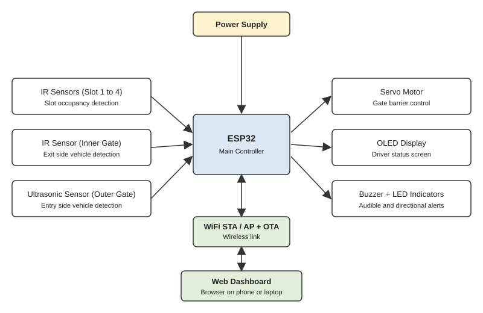
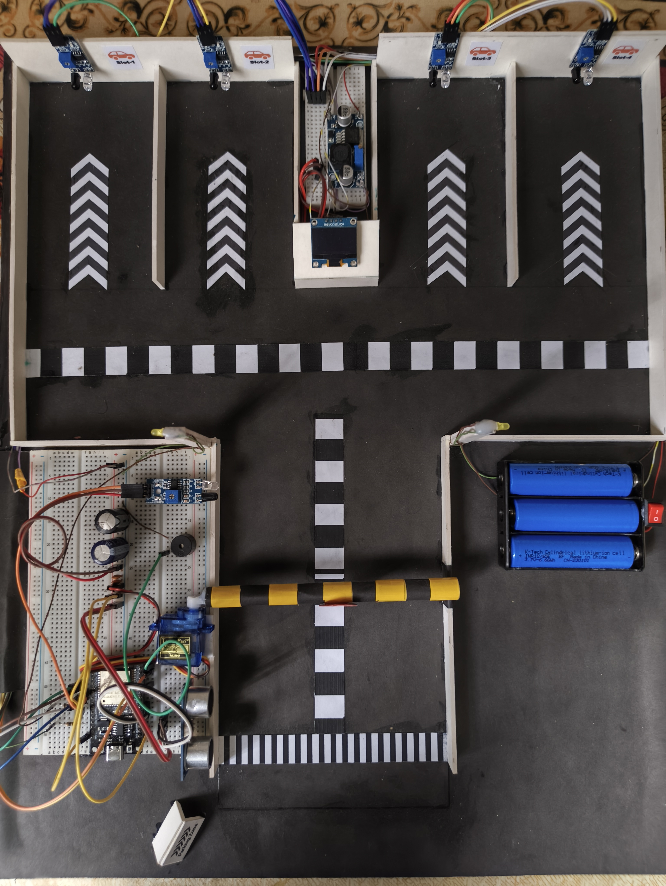
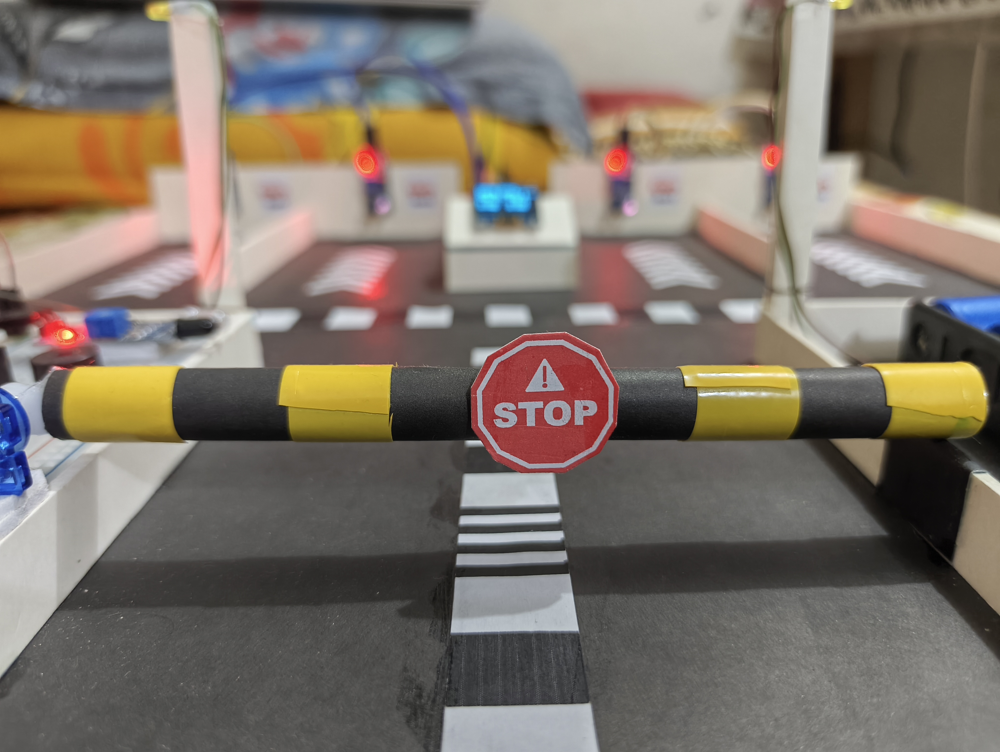
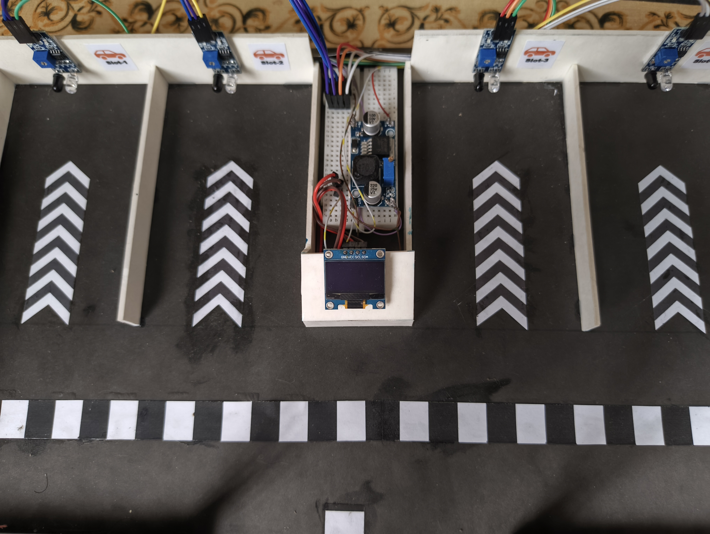
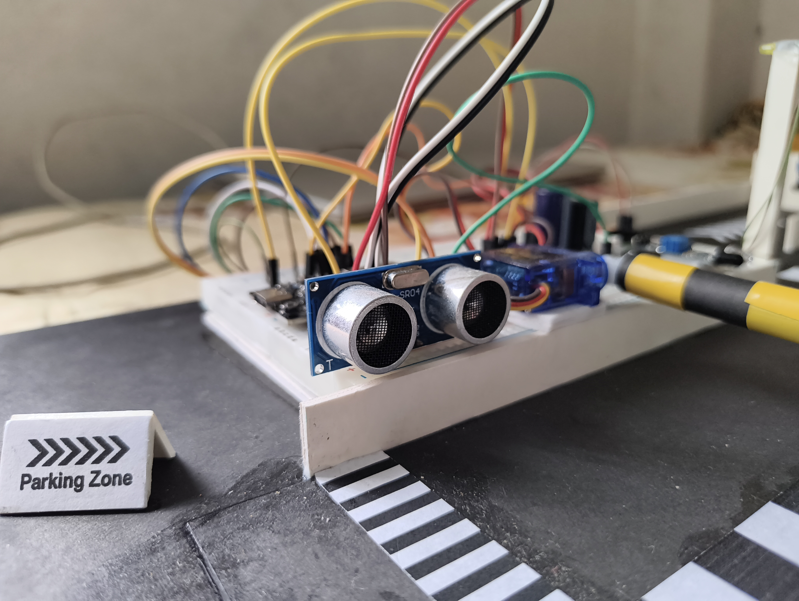
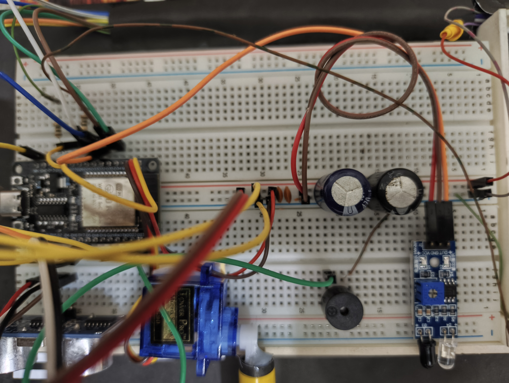

<h1 align="justify">IoT Based Car Parking System with Automated Gate Control</h1>

An ESP32 based IoT smart parking prototype with 4 slots and one automated gate. It validates every vehicle against an actual gate crossing, so it can tell a legitimately parked car from an object placed directly in a slot. Status is shown on an OLED display and on a web dashboard hosted by the ESP32. The ESP32 connects to WiFi in STA mode for IoT access and automatically falls back to its own Access Point (AP) mode if the connection fails, so the dashboard is always reachable.

[Features](#features) | [System Overview](#system-overview) | [Components](#components) | [Pin Configuration](#pin-configuration) | [How It Works](#how-it-works) | [Demo Video](#demo-video) | [Setup](#setup) | [Gallery](#gallery) | [Web Dashboard](#web-dashboard) | [Author](#author)

## Features
- **Fully IoT based:** ESP32 connects to WiFi (STA mode) and serves the web dashboard
- **Dual WiFi mode:** STA and AP, each acts as a backup if the other fails
- **OTA update:** no USB cable needed after the first upload
- **Automatic gate** with ultrasonic sensor and SG90 servo
- **Validated entry counting:** availability comes from verified entries, not raw sensor readings
- **Illegal entry detection** with buzzer alert, OLED warning and dashboard highlight
- **Reserved and Maintenance** slot modes from the dashboard
- **Left/Right LED indicators** show the direction to the assigned slot
- **Live OLED screens:** home, system info, welcome, exiting, illegal entry, parking full
- **Manual gate control** with automatic return to auto mode after a timeout
- **Recent activity log** with relative timestamps

## System Overview

## Components
| Component | Qty | Purpose |
|---|---|---|
| ESP32 development board | 1 | Main controller + WiFi |
| IR sensor module | 5 | 4 slot sensors + inner gate sensor |
| HC-SR04 ultrasonic sensor | 1 | Outer gate vehicle detection |
| SG90 servo motor | 1 | Gate barrier |
| SSD1306 OLED display | 1 | Driver status screen |
| Buzzer | 1 | Audible alerts |
| LED | 2 | Left/Right direction indicators |
| Buck converter | 1 | Voltage regulation |
| 3S battery holder + Li-ion cells | 1 | Power supply |
| Capacitors, breadboards, wires, PVC board | - | Circuit and model body |

Estimated prototype cost: about 2756 BDT.

## Pin Configuration
| Function | GPIO |
|---|---|
| Slot 1 / 2 / 3 / 4 IR | 34 / 35 / 33 / 25 |
| Inner gate IR | 32 |
| Ultrasonic TRIG / ECHO | 16 / 17 |
| Gate servo | 27 |
| OLED SDA / SCL | 21 / 22 |
| Left / Right LED | 26 / 13 |
| Buzzer | 23 |

## How It Works
**Entry**
1. The ultrasonic sensor detects a car at the outer gate.
2. If a slot is free, the gate opens and the buzzer beeps.
3. Crossing the inner IR sensor registers a validated entry.
4. The nearest free slot is assigned and the LED shows left or right.
5. The slot sensor confirms parking and the OLED shows a thank you message.

**Exit**
1. When a validated car leaves its slot, the exit sequence is armed.
2. The gate opens and the OLED shows the exiting slot number.
3. The count decreases after the car crosses the outer sensor, then the gate closes.

**Illegal entry**

A slot occupied without a validated entry, or a Reserved/Maintenance slot being used, triggers the buzzer, OLED warning and a highlighted slot on the dashboard.

<b>Key design decisions</b>

- Availability is counted from validated entries, so lifting a car out by hand cannot free a slot.
- Non-blocking, interrupt-driven ultrasonic reading keeps the web server responsive.
- Debounce and grace periods filter sensor noise.
- Servo signal detach timing removes motor jitter.
- STA and AP dual mode keeps the dashboard reachable even if the WiFi network is unavailable.
- OTA support allows firmware updates without opening the prototype.

<b>Software and libraries</b>

- Arduino IDE with ESP32 board package
- Libraries: WiFi, WebServer, Wire, Adafruit_GFX, Adafruit_SSD1306, ESP32Servo, ArduinoOTA, esp_task_wdt
- Gate state machine: IDLE, OPEN_WAIT, PASS_WAIT, CLOSING

## Test Results

All 7 test cases passed: entry, exit, illegal entry, silent removal after illegal entry, parking full, manual gate control, and reserved slot violation.

## Demo Video
[Watch the demo here](YOUR_VIDEO_LINK)

## Setup
1. Install Arduino IDE and add ESP32 board support.
2. Install the libraries listed above.
3. Add your own WiFi name and password in the code (not included here for security).
4. Upload the code to the ESP32 over USB for the first time.
5. After that, firmware can be updated wirelessly using OTA.
6. **STA mode:** open the ESP32 IP address in a browser on the same WiFi network.
7. **AP mode (fallback):** if the WiFi connection fails, connect your phone to the ESP32 WiFi network and open `192.168.4.1`.

## Gallery
<table>
<tr>
<td align="center"> Parking layout</td>
<td align="center"> Gate with ESP32</td>
</tr>
<tr>
<td align="center"> Barrier gate close-up</td>
<td align="center"> OLED and slot sensors</td>
</tr>
</table>

### Circuit
<table>
<tr>
<td align="center"> ESP32 and servo</td>
<td align="center"> Ultrasonic sensor</td>
<td align="center"> Buzzer and IR</td>
</tr>
</table>

## Web Dashboard
<table>
<tr>
<td align="center"> All slots free</td>
<td align="center"> Illegal entry alert</td>
</tr>
</table>

<b>Limitations and future scope</b>

**Limitations**
- One gate and 4 slots only
- No license plate identification
- Activity log is lost on power reset
- Thresholds are calibrated for this hardware

**Future scope:** cloud logging, license plate recognition, mobile app, multiple gates, payment system.

## Author
**Md. Jewel Rana** 
Electrical & Electronic Engineering 
Daffodil International University
